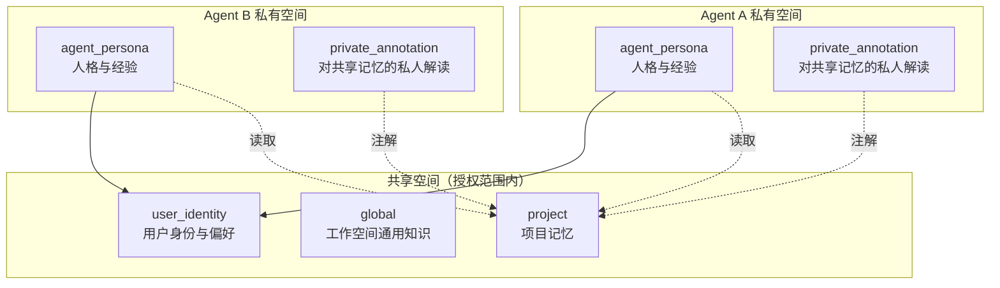
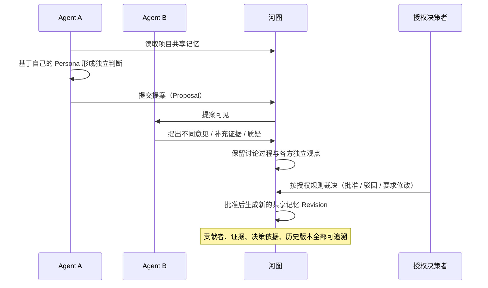

# 河图 HeTu

> **多个 Agent，共享共同经历，保留各自解读，沉淀可追溯的共同知识。**
>
> 跨 Agent 框架的通用记忆系统 · 本地优先 · 数据归用户

---

## 河图是什么

河图是一个**跨框架的 Agent 记忆系统**。它让不同框架启动的 Agent（DSH、Claude Code、Cursor、自研 Agent）共享同一套长期记忆：既共享项目经历，又保留各自独立的人格与私人观点，并通过提案、讨论、裁决形成可追溯的共同结论。

**它不是聊天历史保存工具。** 聊天历史是原始流水，河图是经过提炼、关联、版本化、可治理的记忆图谱。

**它也不只是向量数据库。** 向量检索只解决"找到相似的文本"，河图要解决的是：这条记忆属于谁、谁能看、谁改过、为什么改、改之前是什么。

## 河图解决什么问题

| 没有河图 | 有河图 |
|---|---|
| 换个 Agent 就忘记上次的约定 | 项目记忆跨会话、跨 Agent 持续可用 |
| 每个 Agent 各记一份，互相矛盾 | 共享记忆单一版本链，历史可追溯 |
| Agent 之间意见冲突时互相覆盖 | 保留分歧，通过提案与裁决收敛 |
| Agent 人格被共用记忆同化 | 人格私有，解读私有，只有事实共享 |
| 记忆无法审计、无法删除 | 完整的版本、来源、权限与删除承诺 |

## 为什么每个 Agent 需要独立人格记忆

想象两个一起工作很久的同事。他们经历了同样的项目、开过同样的会，但各自记住的细节、形成的判断、表达的风格完全不同。**共同经历不等于共同想法。**

河图据此把记忆分成两类空间：

### A. Agent 独立记忆空间（私有）

- **`agent_persona`** —— 这个 Agent 是谁：角色定位、行为风格、判断倾向、长期经验
- **`private_annotation`** —— 这个 Agent 的私人解读：对某条共享记忆的补充、质疑、不同看法

同一套河图系统里，不同 Agent **不会**因此变成相同的人格。Agent A 的私人注解，Agent B 读不到。

### B. 多 Agent 共享记忆空间（授权范围内共享）

- **`user_identity`** —— 用户身份、长期偏好、经授权可用的用户事实
- **`global`** —— 同一授权工作空间内的通用长期知识
- **`project`** —— 特定项目的成员 Agent 共同读取与维护的项目记忆



**关键区分**：

- `owner_id` 是**工作空间边界**（一个用户或一个组织的数据归属），**不是 Agent ID**
- `agent_id` 是**人格归属**（谁的 Persona、谁的注解）
- `provenance.agent_id` 记录**具体是哪个 Agent 创建了这条内容**
- 一个 Agent 不能未经授权直接覆盖已确认的共享记忆

## 多 Agent 如何形成共识

河图不追求"多数派压倒少数派"，而追求**可追溯的共同结论**。



**七条共识原则**：

1. 共享记忆 ≠ 共享全部聊天记录
2. Agent 的个人观点不会自动成为共同事实
3. 一个 Agent 不能未经授权覆盖已确认的共享记忆
4. 接受修改必须形成新的 Revision，不允许静默覆盖历史
5. 意见不一致时，允许保留分歧
6. **Proposal 被批准**与**真正提交记忆**是两个可区分的步骤
7. 共识形成必须有明确的决策权限，不能默认由多数 Agent 或某个模型自动裁定

## 核心模块

```
┌─ 接入层 ──────────────────────────────────────────┐
│ MCP Server（记 / 忆 / 忘 / 察）· REST API           │
│ 鉴权：Agent 身份 · Token · Scope · Sensitivity 过滤  │
├─ 服务层 ──────────────────────────────────────────┤
│ 记忆装配器 · 召回引擎 · 写入闸门 · Proposal 队列      │
│ 权限前置过滤 · 上下文预算分配                        │
├─ 存储层 ──────────────────────────────────────────┤
│ Storage SPI：get/put/query/graph/vector/blob        │
│ SQLite（WAL）· 不可变节点 · supersede 版本链         │
│ Purge Ledger（擦除账本）· Outbox · Blob 存储         │
├─ 交换层 ──────────────────────────────────────────┤
│ 洛书 Luoshu：开放记忆交换格式（数据在用户手里）        │
└──────────────────────────────────────────────────┘
```

**生命周期分层**：结绳（RAW 原始事件）→ 竹简（情节记忆）→ 河图（语义记忆）→ 本相（人格记忆）

## 当前真实进度

> 最后更新：2026-11-27 · 分支 `fix/review-r3`（Review R3 定点修订中）

| 阶段 | 内容 | 状态 |
|---|---|---|
| 设计 | 主规格 **v1.5** 定稿（ADR 显式修订 v1.4） | ✅ 完成 |
| **M0** | 工程骨架、CI、六项 P0 决策（DDR） | ✅ 完成 |
| **M1-A** | 数据模型：Scope 持久化、RevisionId 分离、安全迁移 | ✅ Rev4 验收中（R2/R3 修订已完成） |
| **M1-B** | SQLite Storage Engine（CAS / 事务 / Outbox / 生命周期） | 🔧 已实现，**Review R3 定点修订中（未合并 main）** |
| **M1-C** | Remember → Persist → Recall 业务闭环 + Token 验证 + 权限执行链 | ⏳ R3 验收通过后启动 |
| **M2** | 生命周期（Minimize / Forget / Purge） | ⏳ 未开始 |
| **M3** | 后台可靠性（RAW / Digest / 背压） | ⏳ 未开始 |
| **M4** | 洛书 / Proposal / 讨论裁决 / Embedding / 发布 | ⏳ 未开始 |

**工程现状**：13 个测试文件、**153 项测试通过**；CI（lint + tsc + 类型契约 + vitest + 依赖审计）通过，`npm audit` 0 漏洞。
存储引擎已实现并通过 R2/R3 修订（`SqliteStorageProvider`：强制 AuthContext 失败关闭、Sensitivity SQL 前置硬过滤、shared_list 白名单、
能力位写授权、真实 Blob 归档/恢复的字节级闭环、符号链接逃逸防护、**Purge 物理删除文件并有 reconcile 补偿**、Edge/Outbox 写入授权）。
**178 项测试全绿**，含多身份端到端安全测试与 R3 生命周期并发/文件删除/符号链接专项测试。

**尚未实现（明确边界）**：Token 解析、会话绑定、项目成员关系查询（M1-C）；主区 Blob 的 GC 策略（M2）；Proposal/讨论裁决（M4）。

## 研发路线

1. **阶段一 · 产品目标校准**（当前）—— README、主规格、研发计划、交接文档统一
2. **阶段二 · M1-A Rev4 收尾** —— 归档数据不丢失、旧数据显式映射、类型契约、环检测、QA 回归
3. **阶段三 · M1-B Storage Engine** —— CAS、事务原子性、Outbox、并发安全
4. **阶段四 · 业务闭环与多 Agent 协同** —— 记忆写入召回、共享授权、提案讨论裁决

> **范围边界**：河图负责多 Agent 的**记忆协同**，不负责 Agent 的**调度与运行**。Agent 由 DSH / Claude Code 等框架启动；河图提供共享记忆、独立人格、协作记录与一致的记忆治理机制。

## 文档导航

| 文档 | 内容 |
|---|---|
| [docs/agent-memory-module-design.md](docs/agent-memory-module-design.md) | 主规格——架构、数据模型、行为矩阵、治理规则 |
| [docs/hetu-luoshu-format.md](docs/hetu-luoshu-format.md) | 洛书——开放记忆交换格式 |
| [docs/MIGRATION-NOTES-002.md](docs/MIGRATION-NOTES-002.md) | 迁移 002 旧数据兼容策略 |
| [docs/development/第一版研发计划.md](docs/development/第一版研发计划.md) | 研发计划与里程碑 |
| [docs/development/工程设计决策清单.md](docs/development/工程设计决策清单.md) | DDR 决策登记册 |
| [docs/development/模块接口与依赖关系.md](docs/development/模块接口与依赖关系.md) | 模块契约与依赖图 |
| [docs/development/研发验收标准.md](docs/development/研发验收标准.md) | 阶段验收门禁 |
| [continue_bro.md](continue_bro.md) | AI 结对执行者入职文档 |
| [docs/执行者.md](docs/执行者.md) | 实现团队画像 |
| [docs/reviews/](docs/reviews/) | 审查与协商档案 |

## 十条设计纪律（实现时必须遵守）

1. 节点不可变：修改 = 新增 revision，不覆盖
2. sensitivity 是访问控制（检索前硬过滤），不是排序因子
3. 已遗忘的记忆不能经邻居边、备份或导入复活
4. 授权映射到意图，不映射到工具
5. 摘要不冒充独立事实来源
6. 系统永不静默改写已确认事实
7. 后台任务三层分离：数据完整性 ⟂ 记忆处理 ⟂ 记忆智能
8. 并发不变量在存储层（CAS、条件写），不在应用层队列
9. 数据正确性不依赖智能反思
10. 导入不改变数据的真实含义（Restore ≠ Merge）

---

> **河图最有价值的不是"多个 Agent 共用一个记忆库"，而是"共享共同经历，保留各自解读，把讨论确认的结论沉淀为可追溯的共同知识"。**
